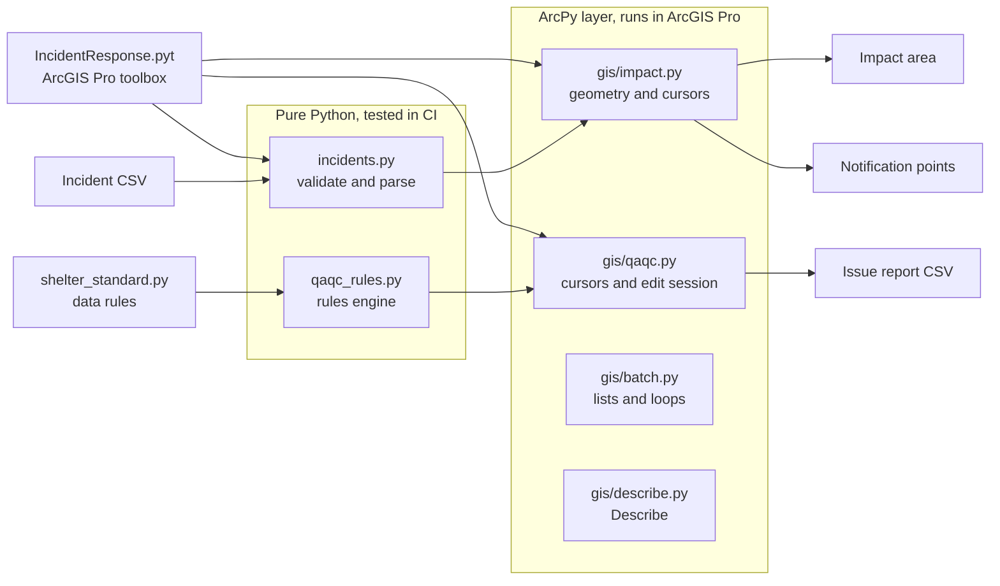

# ArcPy Incident Response Toolkit

[](https://github.com/MoPhD26/arcpy-incident-response-toolkit/actions/workflows/ci.yml)


Python automation for the first hours of an emergency, when GIS teams receive messy field reports, need an impact area fast, and must know exactly which addresses to notify.

The toolkit turns an incident CSV into a validated set of points, builds the impact area with ArcPy geometry objects, writes the notification list with cursors, and checks facility data against a written standard. It ships as an ArcGIS Pro Python toolbox, a Python package, and a notebook walkthrough.

## Why this exists

In emergency GIS, the expensive mistakes are rarely in the analysis. They happen at intake. A dispatcher swaps latitude and longitude, a partner sends data in a different coordinate system, or a shelter is marked Full when it is half empty. This project treats data quality as the first step of the workflow, not an afterthought.

## What it does

| Workflow | What happens | ArcPy skills shown |
|---|---|---|
| **Validate an incident report** | Rejects missing, duplicate, non-numeric, out of area, and swapped coordinates, with a reason for every row | Script tool parameters, custom validation in `updateMessages` |
| **Map the impact area** | Incident points become a multipoint, then a buffered convex hull, measured in a projected system | `arcpy.Multipoint`, `convexHull`, `buffer`, `projectAs`, linear unit conversion |
| **Build the notification list** | Copies every address point inside the impact area to a new layer | `SearchCursor` with a spatial filter, `InsertCursor`, geometry `disjoint` test |
| **Standardize partner data** | Inventories a geodatabase and projects every layer to one system, skipping layers already correct | `ListFeatureClasses`, `ListDatasets`, loops, `Project`, `ExecuteError` handling |
| **Profile and stage data** | Summarizes a dataset and creates an empty copy with the same schema | `arcpy.da.Describe`, `CreateFeatureclass` with a template |
| **Run attribute QA/QC** | Checks a shelter layer against a data standard, writes a CSV report, and can fix formatting errors | `SearchCursor`, `UpdateCursor`, `arcpy.da.Editor` for versioned data |

## How it is built



Design decisions worth noting:

* **Business logic is separate from ArcPy.** Validation and QA/QC rules are plain Python, so they run in CI on every push without an ArcGIS license. ArcPy code stays a thin layer on top.
* **Rejected rows are reported, never silently dropped.** Every tool tells the user what it skipped and why.
* **Read before write.** QA/QC runs in report mode by default. Fixes run inside an edit session, which is safe on versioned enterprise geodatabases.
* **Distances are measured in a projected system.** Buffers are built after projecting to NAD 1983 Texas Centric Albers Equal Area (WKID 3083), not in degrees.
* **A Python toolbox (.pyt), not a binary .atbx.** The tool interface, validation, and execution are all readable in version control and in code review.
* **Standards are data.** The shelter rules are defined once in `shelter_standard.py` and reused by the toolbox, the notebook, and any scheduled job.

## Repository layout

```
arcpy-incident-response-toolkit/
├── src/irtoolkit/
│   ├── incidents.py          # CSV intake and validation (pure Python)
│   ├── qaqc_rules.py         # Declarative rules engine (pure Python)
│   ├── shelter_standard.py   # Example data standard for a shelter inventory
│   ├── logging_utils.py      # Logs to the terminal or the Pro messages pane
│   └── gis/
│       ├── describe.py       # Dataset profiling and staging with da.Describe
│       ├── batch.py          # Inventory and batch projection with lists and loops
│       ├── impact.py         # Geometry objects and cursors for the impact area
│       └── qaqc.py           # Cursor based QA/QC with edit sessions
├── toolbox/IncidentResponse.pyt   # ArcGIS Pro Python toolbox (3 tools)
├── notebooks/flood_response_walkthrough.ipynb
├── tests/                    # pytest suite, runs without ArcGIS
├── data/sample_incidents.csv # Synthetic data with deliberate errors
└── scripts/make_sample_data.py
```

## Quick start

### In ArcGIS Pro

1. Clone or download this repository.
2. In the Catalog pane, right click **Toolboxes**, choose **Add Toolbox**, and select `toolbox/IncidentResponse.pyt`.
3. Run **Validate Incident Report** on `data/sample_incidents.csv` to see the validator catch five bad rows.
4. For the mapping and QA/QC tools, point them at your own address points and shelter layers, or build them from the public data listed in [`data/README.md`](data/README.md).

### Run the tests (no ArcGIS needed)

```bash
pip install -r requirements-dev.txt
pytest -v
```

### Use it from Python in ArcGIS Pro

```python
import sys
sys.path.insert(0, r"C:\path\to\arcpy-incident-response-toolkit\src")

from irtoolkit.incidents import load_incidents
from irtoolkit.gis.impact import impact_area, affected_features

result = load_incidents("data/sample_incidents.csv")
print(result.summary())   # 25 incidents loaded, 5 rows rejected

area = impact_area(result.incidents, buffer_distance=500, work_wkid=3083)
affected_features(area, r"C:\GIS\Flood.gdb\AddressPoints",
                  r"C:\GIS\Flood.gdb\NotifyAddresses", ["FULL_ADDRESS", "ZIP"])
```

## Sample output

From the validator, on the included synthetic file:

```
25 incidents loaded, 5 rows rejected

line  27: duplicate incident_id INC-0005
line  28: coordinates out of valid range (latitude and longitude look swapped)
line  29: coordinates are not numeric
line  30: outside response area
line  31: missing incident_id
```

From the shelter standard, on one messy record:

```
[name spacing] leading or trailing spaces  -> fixed to 'Eastside Rec Center'
[status domain] 'full' should be 'Full'  -> fixed to 'Full'
[type domain] 'pet friendly' should be 'Pet Friendly'  -> fixed to 'Pet Friendly'
[inspection date] 2010-03-01 is outside 2015-01-01 to 2026-11-24
[full status check] status is Full but occupancy is under 90 percent of capacity
```

## Requirements

* ArcGIS Pro 3.2 or later for the ArcPy layer and toolbox (the cursor `spatial_filter` argument was added in 3.2)
* Python 3.9 or later for the pure Python modules and tests

## Roadmap

* Publish the notification layer to ArcGIS Online with the ArcGIS API for Python
* Schedule the QA/QC run as a nightly job with an emailed summary
* Add a Field Maps form with Arcade expressions that enforce the same shelter standard at the point of collection

## About

Built by **Mogahid Hussein, Ph.D., GISP**, a former Esri Senior Instructor who taught ArcGIS Pro, Python, and Arcade to more than 1,000 professionals. My doctoral research measured social vulnerability and flood exposure across 13 Texas counties ([texas-svi-pipeline](https://github.com/MoPhD26/texas-svi-pipeline)).

All sample data in this repository is synthetic. No proprietary course materials or datasets are included.

## License

MIT
